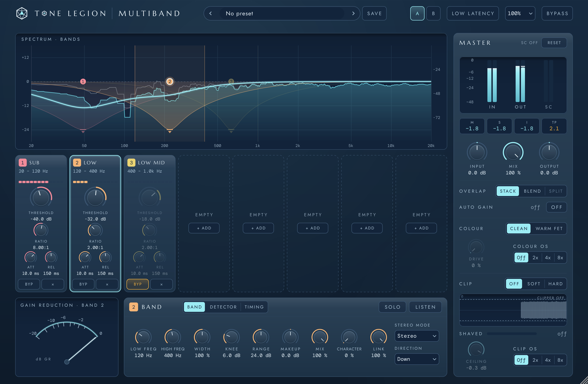

# Tone Legion Multiband

Multiband compressor plugin (JUCE 9). **Development build: feature-complete enough to audition, nothing in it has
been listened to or run in a DAW yet.** Up to eight freely placed bands with a feed-forward compressor each,
sidechain routing, stereo and mid/side modes, lookahead, timing options, a colour stage, metering, presets and an
editor. The band filters come from the *A-prime* engine (constant width) behind `dsp::IBandEngine`; the original
*A3* engine (its bell narrows with depth) is no longer offered in the editor and stays in the code as a test
reference. Each band has a Width control that widens or narrows its filter around the band's centre. Latency is 0 unless lookahead or oversampling is
in use, and a **Low Latency** switch turns both off at once.



*The editor with three bands, as rendered by `tl_tests "[.screenshot]"` (not a DAW screenshot).*

**License: none selected yet.** The repository is public, but no license has been
granted: all rights are reserved until the owner chooses one. Third-party code under `libs/` keeps its own licenses. The fonts embedded in the editor (Marcellus, Jost, DM Mono, in `resources/fonts/`) are under the SIL Open Font License 1.1; their licence texts sit next to them.

## Status

| Item | State |
|---|---|
| Parameter schema (248 host parameters, one table) | **PROVISIONAL / NOT FROZEN** (`source/ParameterSchema.cpp`); threshold -80..+12 dB in 0.1 dB steps |
| Band engine | A-prime regions; A3 kept only as a test reference (see "Band engines") |
| Plugin / manufacturer codes (`Tlmb` / `Tlgn`) | **PLACEHOLDER**, uniqueness and registration not checked |
| State serialization, band topology, slot allocation + undo | implemented, tested |
| Presets / A-B | starter presets (built in, not yet judged by ear), user preset files, A/B compare (`source/PresetManager.*`) |
| Builds and validators | see **CI and validation** below (Linux x64, macOS arm64, Windows x64) |
| Real DAW hosts | **not tested** on any platform |
| Editor | `source/ui/`, Soft Glass look: spectrum display where each band is one object you drag (move, Makeup, dynamics range, Width on the wheel) over the live response curve; band cards; three-tab inspector with a gain-reduction needle; master strip with meters, loudness and true peak, overlap, auto gain, colour and clipper; preset browser, A/B, Low Latency, window scale 75-150 %, keyboard undo / redo |
| Usable in a host for auditioning | **built for it, not yet tried**: bands can be created in the editor; see `docs/listening/PROTOCOL.md`. No DAW session has been run |
| RTSan | `-DTL_ENABLE_RTSAN=ON` requires clang >= 20 and errors otherwise (never faked) |
| ASan + UBSan | `-DTL_ENABLE_ASAN_UBSAN=ON` (GCC/Clang): whole build instrumented, UB fatal; the test heap detector then counts `operator new/delete` only |

## What is not done

- **Nobody has listened to this plugin and it has not been opened in a DAW.** Everything below "tested" means
  automated tests, format validators in CI and sanitizers. See `docs/listening/PROTOCOL.md` for the manual checks.
- A-prime is the band engine; the listening pass in `docs/listening/PROTOCOL.md` is still to confirm it by ear.
- Designs chosen without a listening session: the timing options (adaptive release, frequency-dependent release,
  transient preservation), the colour curve, automatic gain, the starter presets. Expect retuning.
- Inert parameters with no control in the editor: `quality`, `lpLength` (linear-phase mode: deliberately not
  started).
- Per-band character runs at the base rate (anti-aliased, not oversampled); nobody has judged its sound yet.
- Band overlap: Stack and Blend work; Split is listed in the editor but not built yet (it cannot be picked there,
  and a project or automation that sets it gets Stack).
- Editor: no compact layout (at 100 % the window needs at least 1136 x 772 points; the 75 % scale brings that to
  852 x 579); no band suggestions; keyboard and
  screen-reader use has not been tried by a person.
- Automation is applied once per audio block (see "CI and validation").
- The loudness meter has not been run against the official EBU test files.
- The parameter schema is not frozen (IDs and ranges can still change, which would break saved projects), the
  plugin codes are placeholders, no license has been chosen, there is no code signing or notarisation, the only installer is the Windows
  beta one (no Mac installer),
  and AAX is not built.
- RTSan has not been run; the evidence for real-time safety is the audio-thread heap detector in the tests plus
  ASan / UBSan runs.

## Dependencies (git submodules in `libs/`, pinned)

| Path | Source | Pin |
|---|---|---|
| `libs/JUCE` | juce-framework/JUCE | tag `9.0.6`, `654bdbc7a9db0dae90849b44abe91f339e9f0768` |
| `libs/clap-juce-extensions` | free-audio/clap-juce-extensions | `3837f4a6ed2ab0ba46aba69ae5b7041c7c64ce74` (+ its `clap`, `clap-helpers` submodules) |
| `libs/Catch2` | catchorg/Catch2 | tag `v3.16.1`, `08092139210881f01a34e60c5f2fd6afa0ea4024` |

```sh
git submodule update --init --recursive
```

## Build (Linux)

Needs cmake >= 3.22, a C++20 compiler, ninja, and dev packages for freetype2, fontconfig, x11, xext
(no ALSA / curl / Xrandr / Xinerama / Xcursor / GTK / WebKit: the corresponding JUCE features are compiled
out via definitions in `CMakeLists.txt`, and `juce_audio_devices` / `juce_audio_utils` are not linked).

```sh
cmake -S . -B build -G Ninja -DCMAKE_BUILD_TYPE=Release
cmake --build build --target ToneLegionMultiband_VST3 ToneLegionMultiband_CLAP tl_tests
ctest --test-dir build --output-on-failure
```

Options: `TL_BUILD_CLAP` (default ON; compatibility gate, the wrapper officially claims JUCE 6/7/8 only),
`TL_BUILD_TESTS` (ON), `TL_BUILD_BENCH` (ON), `TL_ENABLE_RTSAN` (OFF), `TL_ENABLE_ASAN_UBSAN` (OFF).
Keep the build directory outside the repo or under `build/`.

Measurements and benchmark (neither is part of `ctest`'s pass/fail beyond the assertions in the tests):

```sh
TL_MEASURE_DIR=/tmp/tl-measure build/tests/tl_tests "[dsp]"      # writes CSV (responses, phase, GR traces)
python3 tools/plot_measurements.py /tmp/tl-measure                 # numpy + matplotlib, writes PNGs there
build/bench/tl_bench [seconds]                                     # ns/frame and % real time, 48 kHz, block 128
```

Updating the parameter manifest after an intentional schema change:
`TL_UPDATE_GOLDEN=1 build/tests/tl_tests "[ids]"` then review the diff of `tests/golden/parameter_ids.txt`.

## Layout

- `source/PluginIdentity.h` identity constants (checked against JUCE macros and CMake by tests)
- `source/ParameterSchema.*` the whole schema as one table, builds the `ParameterLayout` (one group per band + Global)
- `source/BandSlots.*` band topology (`used[16]`, `everUsed[16]`, LRU counter), create/delete as `UndoableAction`s
- `source/ParameterUndo.*` records knob edits (one step per gesture) into the same undo history
- `source/StateSerialization.*` parse -> validate -> migrate -> normalise -> `replaceState`
- `source/PresetManager.*` starter presets, user preset files, A/B compare (message thread)
- `source/PluginProcessor.*` buses, pass-through, bypass, creates the editor
- `source/ui/` editor: `Theme.h` (Soft Glass colour, radius and size tokens, panel and card painters), `ValueFormat`
  (value text with units), `Controls` (look-and-feel, knob / drop-down / toggle bound to parameters), `SpectrumView`,
  `ConsoleMeters` (gain-reduction needle, clipper view), `MeterRail`, `BandColumn`, `BandInspector`, `PluginEditor`
- `docs/listening/PROTOCOL.md` manual listening and host checks (not yet performed)
- `source/rt/` real-time safe pieces (`FiniteGuard`, `AnalyzerFifo`, `LevelMeter`, `LoudnessMeter`)
- `source/analysis/` editor-side spectrum analysis (`SpectrumAnalyzer`, small radix-2 FFT)
- `source/dsp/` band processing: `IBandEngine` (interface), `DynamicsCore` (engine-independent: edge smoothing,
  detector, gain computer, link, attack/release, activity ramp, band lifecycle -> per-sample band gains),
  `BandEngineBase` (chunking, guards, metering, lifecycle and every engine-independent stage), `A3RegionEngine` and
  `APrimeRegionEngine` (only the filter structures), `TptSvf`, `EdgeSmoother`, `GainComputer`, `BandDetector`, `GrSmoother` + `ActivityRamp`, `Ramp` (20 ms gain / mix ramps), `KWeighting`, `OutputStage`
  (automatic gain, clipper), `Lookahead`, `Oversampler`, `Character`, `GrMeter`
- `bench/` CPU benchmark, `tools/plot_measurements.py` plots of the measurement CSVs
- `tests/` Catch2 suite, `tests/support/` offline renderer and audio-thread heap detector (`operator new`/`delete` override plus, on glibc, `malloc`/`calloc`/`realloc`/`free` interposition)

## DSP (P1-M2, experimental)

Per used slot, in slot order, per channel (dynamics in `source/dsp/DynamicsCore.cpp`, filters in `source/dsp/A3RegionEngine.cpp`):

- **A3 region:** TPT SVF with prewarped edges, `g = sqrt(wl wh)`, `R = (wh - wl)/(2g)`, delta form
  `y = x + (gEff - 1) 2R bp`. At `gEff == 1` the output is bit-identical to the input. The response is a bell:
  full depth only at the (digital) centre, about -2.7 dB at the nominal edges for -12 dB, width shrinking with depth,
  2.4 dB ripple at the junction of two adjacent bands, up to ~37 deg interchannel phase when unlinked channels get
  different gain. These are the documented reasons it is experimental.
- **Edges:** one-pole smoothing (20 ms) in the log2 domain, ordering resolved in DSP, runtime clamp
  `fLo >= 10 Hz`, `fHi <= 0.45 fs`, `fHi >= fLo * 2^(1/24)` (never written back). Coefficients change only on an
  absolute 16-sample grid (sample counter reset in `prepareToPlay`).
- **Detector:** main input before compression, by default the band's own range (see detector routing below):
  Butterworth HP at `fLo` then LP at `fHi`;
  peak, RMS (`rmsTime`) or blend (`detBlend`); Giannoulis/Massberg/Reiss soft knee (`ratio` 100 = infinity);
  `range` limit; stereo `link`; decoupled attack/release smoothing in the GR domain; 10 ms activity ramp for
  used/unused, band bypass and global bypass. Host bypass (`processBlockBypassed`) uses the same 10 ms ramp to
  neutral, then outputs the input bit-exactly while the states keep running; leaving it ramps back in.
- **Gain staging:** signal path `input gain -> bands -> global mix -> automatic gain -> output gain -> clipper`. Per band, `makeup` is part of
  the wet band and `mix` scales the band's whole gain change, `gEff = 1 + activity * mix * (gComp * makeup - 1)`
  (for one A3 band this is an exact parallel blend). The global `mix` blends with the input after the input gain,
  which is exact only because the A3 engine has zero latency and passes the input unchanged when neutral. All five
  are ramped over 20 ms (gains linearly in dB) and land exactly on their targets; at the defaults every stage is
  skipped and the output is bit-identical to the build without them. Host bypass and the plugin bypass ramp the
  input and output gains to unity, so bypass returns the input exactly. The GR meter shows compression only.
- **Detector routing (per band, always feed-forward: every source is taken before any band processing):**
  It is edited on the inspector's Detector tab; a band that listens to an External sidechain the host has not
  connected shows an amber warning there, and the master strip shows the sidechain's state (off, silent, live).
  - `scSource`: main input (after the input gain) or the external sidechain bus. A mono sidechain feeds both
    channels. With no sidechain connected an External band gets silence and does nothing; it never falls back to the
    main input. Switching the source crossfades the detector input over 5 ms. Sidechain audio is only read (through
    a guarded copy) and cannot reach the output.
  - `scMode`: the detector's frequency range is the band's own, another slot's (`scRef`, its `fLo`/`fHi`), or a
    custom one (`scLo`/`scHi`), smoothed like the band edges. A reference to a slot that does not exist falls back
    to the band's own range. Deleting a followed band converts its followers to that range as a custom range.
  - `scChan`: `L/R` (per lane), `Mid`, `Side`, `Sum` (L+R, 6 dB hotter than Mid for in-phase material) or `Max`
    (per lane, deeper reduction applied to both). With a mono main input every choice except `Sum` uses the mono
    sum (a stereo sidechain is summed; `Side`, which a mono signal does not have, means the same as `Mid`).
- **Stereo modes (`stereoMode`, stereo only):** `Stereo` (left/right linked by `link`; the link only acts with
  `L/R` detection, the other detector channel choices already give both lanes the same signal), `Left/Right` (independent),
  `Mid` or `Side` (only that component of the band is processed, the other is untouched), `Mid/Side` (both,
  independently). Mid/side needs no global encode: the A3 region filter is the same linear system on both channels,
  so its band-pass output is split into M and S and the two gain changes are added back per channel. Changing the
  mode fades the band out over 10 ms, swaps, and fades back in; while any lookahead delay is running the swap also
  waits another 10 ms, until every gain still in the delay lines is neutral. In the mid/side modes the two GR meter
  channels are mid and side.
- **Automatic gain (`autoGain`, v1):** a slow loudness match. The K-weighted mean square (BS.1770 pre-filter,
  re-derived per sample rate; the 48 kHz coefficients are checked against the published values) of the dry signal
  (after the input gain) and of the processed signal are integrated over 1 s; the processed signal is scaled by
  `sqrt (dry / processed)`, limited to +-12 dB and smoothed (250 ms). While the dry signal is below -70 dB the
  correction is held. It restores the average level and does not follow individual gain-reduction events; fast
  level changes are not compensated. The target is updated on the absolute 16-sample grid, so static settings stay
  bit-identical across block layouts. This is not a loudness meter: no gating, no LUFS read-out.
- **Clipper (`clipMode`, `clipCeiling`):** the very last stage. *Hard* clamps at the ceiling. *Soft* is exactly
  linear up to half the ceiling, then a tanh section that approaches the ceiling without exceeding it (value and
  slope continuous). At the base rate both alias on strong high-frequency overs. **`clipOversampling`** (Off / 2x /
  4x / 8x, not automatable, Off by default) runs the clipper at 2x / 4x / 8x with the same linear-phase half-band
  filters as the colour stage. Its own latency (47 / 53 / 55 samples) is reported, and added to the colour's,
  whenever it is on, whether or not the clipper is, so switching the clipper never changes the latency (with the
  clipper off the output is then an exact delay). The decimation filter rings a little past the ceiling on clipped
  peaks (about 1.1 dB at most, measured), so a final clamp at the base rate keeps the ceiling exact (owner's
  decision, 2026-11-24: a control named Ceiling must hold); that clamp brings part of the aliasing back. Measured with a 5 kHz tone 12 dB over a -6 dB ceiling (folds at 3, 7 and
  13 kHz): about 10 dB less aliasing with the clamp, 25 to 60 dB less without it. A factor change crossfades the
  oversampled clip with the base-rate clip of the delayed signal and the delay to its new length (10 ms each), so the
  ceiling holds throughout. Bypass, and switching the clipper off, fade it out over 20 ms (bypass then
  returns the input even above the ceiling); switching it on fades it in over 20 ms, so the ceiling holds from then
  on. Changing between *Soft* and *Hard* crossfades the outputs of the two curves, so the ceiling holds throughout.
  Solo and Listen pass through the clipper as well.
- **Lookahead (`lookahead` per band 0..10 ms, `constantLatency`):** the audio is delayed by the largest lookahead of
  the used bands (or by the full 10 ms with constant latency on) and that delay is reported to the host as latency;
  each band's gain is delayed by the difference, so it leads the audio by exactly its own lookahead. A neutral band
  with lookahead is an exact delay; bypass keeps the same delay. When a value changes while running, the delay taps
  crossfade over 10 ms and the new latency is reported from the message thread (hosts differ in how they react to a
  latency change during playback; constant latency avoids it). A tap is only faded in once that much history has
  been collected, however quickly the value is changed again. Every slot has its gain delay whether it is used or
  not, and a band that is not running has a history of unity gains: adding a band never replays anything, and a
  removed band is retired only after its last delayed gain has been applied. With all lookaheads at 0 nothing is
  delayed or copied. Note that an abrupt onset is largely broadband and therefore outside a band's region: lookahead removes
  the in-band overshoot, not the click.
- **Timing character (per band, 0..100 %, 0 = off and bit-identical; v1 designs, to be judged by ear):**
  - `freqRel`: the release is scaled by the band centre, `release * (1 kHz / sqrt(fLo fHi)) ^ (0.5 amount)`:
    3.16 times longer at 100 Hz and 3.16 times shorter at 10 kHz at 100 %.
  - `adaptRel`: a slow follower of the gain reduction (falls with `max (8 release, 400 ms)`, rises 2.5 times slower)
    sets a floor for the recovery, `reduction = max (smoothed, amount * slow)`. A brief peak recovers at the set
    release and leaves only a small remainder; sustained reduction recovers several times slower. It never produces
    more reduction than the plain compressor reached.
  - `transient`: an onset detector (5 ms peak follower against its own 30 ms average) scales the reduction command
    back during onsets, `gr *= 1 - amount * onset`. Steady signals are compressed exactly as before.
- **Audition (not parameters, never saved):** *Solo* outputs one band's own component after its gain (for A3:
  `gEff * 2R * bp`, mid/side decoded to left / right); *Listen* outputs that band's detector signal (after its
  detector filter, before the envelope) 6 dB down, which with an external source is the one way sidechain audio
  reaches the output. Both replace the signal before the clipper (not affected by the colour, the global mix,
  automatic gain or the output gain) and are delayed to line up with the normal output (lookahead and oversampling
  latency); after switching, the audition fades in once its delayed signal has arrived. One at a time, 10 ms
  crossfades, off while bypassed, and cleared by a state or preset load, by A/B, by removing that band and by
  closing the editor.
- **Colour (`charModel`, `charDrive`) and `oversampling`:** a global coloration stage on the wet signal, after the
  bands and before the global mix. One original model, *Warm FET*: an asymmetric tanh curve with unity small-signal
  gain, `y = (tanh (k (x + b)) - tanh (k b)) / (k (1 - tanh^2 (k b)))`, `b = 0.15`, `k = 2.5 drive`, followed by a
  5 Hz DC blocker. The bias gives even harmonics, tanh the odd ones and gentle peak rounding. It is not a model of
  any hardware. Oversampling (2x / 4x / 8x) is linear-phase: three Kaiser half-band FIR stages (95 / 25 / 17 taps,
  stop band about 84 dB for the first stage from 0.56 fs and about 88 dB for the other two, as measured from the
  coefficients in review) with a round-trip latency of 47 / 53 / 55 samples, reported to the host whenever
  oversampling is on (whether or not the colour is in use, so that automating the colour never changes the
  latency); the clean path and the dry signal are delayed by the same amount, so the clean model with oversampling
  is an exact delay. Measured at 48 kHz with a 9 kHz tone at full drive, the folded 4th and 5th harmonics drop by
  more than 40 dB at 4x. Switching the colour on while oversampling runs dips the level by about 10 % for a
  millisecond (measured in review; no step). The output clipper has its own oversampling (see Clipper). Each half-band
  stage runs in polyphase form: it skips the zero taps and adds the mirrored taps before multiplying, the same
  output as the full FIR (tested against a direct-form reference). Measured with `tl_bench` (Release, GCC, stereo,
  48 kHz, block 128, ns per frame): colour at 2x / 4x / 8x costs about 144 / 219 / 339, the hard clipper about
  99 / 139 / 210 (before: about 345 / 520 / 790 and 338 / 518 / 777).
- **Per-band character (`character`, "Character" on the inspector's Band tab, 0..100 %, 0 = off and
  bit-identical):** the Warm FET curve of the colour stage (same curve, 100 % = the same full drive), applied to the
  band's own component after its gain, so after its compression, makeup and band mix. What it adds is the curve's
  residue `f(u) - u`: the curve has unity small-signal gain, so the band's linear response is unchanged and only
  harmonics of what is in the band are added; what lies outside the band is not saturated (a tone outside the band
  stays within 0.1 dB, measured). The residue is anti-aliased with the first-order antiderivative method
  (`(H(u) - H(u_prev)) / (u - u_prev)`, `H' = f - id`, in double precision; this puts it half a sample behind the
  band, an offset of about 10 us at 48 kHz), has its DC removed (5 Hz) and its drive ramped per sample over 20 ms.
  No latency, no oversampling. On a Mid band the side is left alone (and the mid on a Side band); band bypass and
  host bypass take it out. Measured: a 100 Hz tone at 0.7 in a 60 - 300 Hz band at 100 % gets its 2nd harmonic at
  -18 dB and its 3rd at -20 dB; a quiet signal (-60 dBFS) changes by less than -50 dB of itself. Aliasing (offline
  check of the curve on a 7 kHz tone at 0.7, full drive): about -35 dB relative to the tone, 8 dB less than without
  the anti-aliasing; bright bands at high drive may sound grainy. Cost (`tl_bench`, 8 bands compressing, all at 50 %,
  stereo): about 920 ns per frame against 570 without.
- **Inert parameters (exist, no effect yet):** the globals `quality`, `lpLength`.
  `overlapMode` works for Stack and Blend; its third choice, Split, acts as Stack until it is built.
- **Spec amendment (accepted in review):** "becoming used -> states reset, activity ramps from 0" applies to a band
  that was fully skipped. A slot that is used again while it is still fading out (e.g. undo right after delete)
  keeps its filter/detector/smoother states and edges and ramps up from its current activity, so there is no
  discontinuity. Pinned by the test "Band re-used during its fade-out continues without reset".
- **Real-time safety:** no allocation after construction (fixed 256-sample internal chunk, so any host block size
  works), no locks or I/O; input guard (non-finite -> 0), non-finite internal state -> band reset, output guard;
  `ScopedNoDenormals`. A finite but absurd input (around 3e38, or less with a large input gain) overflows inside:
  the output stays finite, at the cost of 10 - 25 ms of silence per event while the affected states are reset
  (measured in review). Parameters are read once per host block, so automation takes effect at block boundaries:
  static parameters are bit-identical for any block layout, automated ones differ slightly between layouts.
- **GR metering:** `PluginProcessor::getGainReductionMeter().getGainReductionDb (slot, channel)`, lock-free,
  the minimum applied band gain of the last block in dB; `readAndResetHeldGainReductionDb (slot, channel)` returns the
  deepest value since its previous call (min-hold until read, for UI polling), or the last block's value when no
  block was processed in between.

## Band engines (both experimental)

A numerical study (kept outside this repository) compared the original engine (A3) with four alternatives against hard
gates: exact null at unity gain, no response above the commanded range, no dynamic overshoot above +0.5 dB with
smoothed gains, stability, bounded cost. Results, in short:

| Candidate | Result |
|---|---|
| **A3** (the original engine): `y = x + (G - 1) 2R bp(x)` | survives. Known weaknesses: the bell narrows with depth (a 1-octave band acts over 0.85 octave at -3 dB and 0.06 at -48 dB), the nominal edges never get deeper than about -3 dB, 2.4 / 7.1 dB ripple between adjacent bands at -6 / -12 dB, cut and boost differ |
| A-prime as first written (damping follows the gain every sample) | **fails**: +8.6 dB overshoot on 24 dB gain steps, +23 dB on 48 dB steps |
| **A-prime**, modified (below) | survives: constant width, half the command (in dB) at the nominal edges, cut and boost mirror images, junction ripple 0.95 / 2.1 dB, overshoot at most +0.26 dB, cost equal to A3 |
| Complementary tree | **fails**: up to +4.3 dB above unity with cut-only commands |
| A3 with normalised gain commands | no mapping is both exact and free of boosts on freely placed bands; not worth its cost |
| Conventional LR4 crossover | **fails** the exact-null gate (already known) |

`APrimeRegionEngine`: `R' = R / sqrt (Gw)`, `u = 2R' x`, `y = x + (G - 1) bp_R' (u)`, where `Gw` is a lagged copy of
the gain (one pole in dB, time constant `max (5 ms, 4 / (R w0))`) updated with the coefficients on the 16-sample
grid, and the output term uses the instantaneous gain. Its own weaknesses, measured: the constant-width shape is
only reached after that lag (5 ms for an octave at 1 kHz, hundreds of milliseconds for narrow low bands; until then
it behaves like A3); transient deviations of about -15 to -17 dB relative to an in-band tone on large cuts, which
A3 does not have; the skirts of adjacent bands add (eight adjacent bands at -12 dB reach -18 dB); no flat top; both
lanes of a band share one width. Graphs and gates eliminate candidates; which engine sounds right is the owner's
decision after listening.

**Default: A-prime** (the owner's pick, 2026-11-24, made on the measurements above and below; the listening pass in
`docs/listening/PROTOCOL.md` is still to confirm it). A new instance starts on A-prime and its project saves the
choice. **Since the owner's call of 2026-11-24 the editor has no engine switch**: every project opens on A-prime,
including one saved with A3 selected or from before A-prime was the default (which may sound slightly different
from how it was made). Use the band's Width control to widen or narrow a band instead. Measured differences to know about: where several
adjacent bands compress together, A-prime goes deeper than each band's command (four adjacent bands each at -6 dB
reach -6.3 to -8.4 dB between 200 Hz and 3.5 kHz, A3 -4.3 to -7.4 dB); a band's Mix is an exact parallel blend
only with A3; with Mid/Side or a stereo link below 100 % the two lanes of an A-prime band share one width. CPU is
the same (8 bands, stereo: about 590 ns per frame for either engine).

**Band overlap (`overlapMode`, "Overlap" in the master strip).** Each band's filter has skirts that reach into its
neighbours, so with **Stack** (the default, and how every earlier version sounds) the gain reductions of bands that
compress together add up where they meet. **Blend** eases each band back by what its neighbours' skirts already do at
its centre, so each band lands on its own command there. How: at each of 16 points per block, per lane, it solves
"applied gain + neighbours' skirts at my centre = my command" (dB) with exact closed-form models of each pair of
bands (A3's or A-prime's, whichever engine runs), linearised at the last solution and refined with a few Gauss-Seidel
sweeps. A band is never pushed past its own command or to the other side of 0 dB, so a cut never becomes a boost and a
band that is not compressing is never touched; a cut next to a boost is left as Stack has it. One band alone, or Stack,
is bit-identical to before. Switching fades over 20 ms; no latency. Measured (four adjacent bands, 120 Hz - 5 kHz,
level between 200 Hz and 3.5 kHz):

| Each band at -6 dB | Stack | Blend |
|---|---|---|
| A-prime | -8.4 to -6.3 dB | -6.1 to -4.9 dB |
| A3 | -7.4 to -4.3 dB | -6.0 to -3.9 dB |

With A-prime at deeper settings Blend gives -12.1 to -9.8 dB (bands at -12 dB) and -24.1 to -19.2 dB (bands at
-24 dB); the tests check that Blend is never more than 0.1 dB deeper than the command at -3, -6, -12 and -24 dB, for
both engines, while Stack is at least 0.5 dB deeper.

Two bands over the same range at -6 dB each: Stack -12 dB, Blend -6 dB. Between band centres Blend sits a little
short of the command (up to about 1 dB at -6 dB, 5 dB at -24 dB with four bands), because the correction is solved
at the centres. Known limits: when Mid/Side bands sit next to Left/Right bands the lanes are paired by index, which is
an approximation; the gain-reduction meters still show what each band's compressor asks for, not what Blend applies.
Cost (`tl_bench`, 8 bands compressing, stereo): about 770 ns per frame against 610 for Stack.

The engine choice was a listening switch in the editor (now removed; the internal switch remains for the tests):
saved with the project, not a parameter, not changed by presets or A/B. The dynamics (detector, gain computer, timing) are the same code for both engines, so a
comparison isolates the filter structure, and a changeover while audio plays is built on that:

- The engine that is switched in takes over everything the two share from the one that is running
  (`IBandEngine::continueFrom`: detector and envelope states, gain ramps, lookahead history, automatic gain, the
  position on the coefficient grid). From its first sample it computes the same band gains as the running engine;
  a test requires them to be bit-identical. Before this, the new engine started from a clean state and was heard
  settling: +5.0 dB with a 100 ms attack, +8.5 dB with 300 ms, +4.2 dB with a 300 ms RMS window, -6.8 dB with
  automatic gain (125 ms after the click). Now: within 0.01 dB for a tone at the band centre in all settings
  measured (`tests/RepairMeasurements.cpp`).
- The band filters are its own, but they do not start from silence either: each band's filter memory is carried
  over in a form both kinds of filter share (the state of the band's unity-peak band-pass). That is exact for a
  band at unity gain (a bypassed band, a band below threshold) and, for a band that is applying gain, exact for
  what lies at the band centre and close for the rest of the band, where the two engines differ in damping.
- For that remaining difference the new engine first runs unheard on a copy of the input, for four time constants
  of the narrowest active band, `4 / (pi * bandwidth)` (longer by the square root of a makeup boost), at least
  10 ms and at most 250 ms; then the two outputs are crossfaded over 20 ms. For ordinary bands the change is heard
  10 to 30 ms after the click; for a 60 - 70 Hz band after about 150 ms. Measured with a tone at the band centre,
  worst level error after the click: 0.00 dB for bands from 20 - 21 Hz upwards, compressing or with +24 dB makeup,
  and 0.2 to 0.4 dB for a 10 - 10.3 Hz band, whose filter rings for seconds (before the carry-over: up to 17 dB
  for such bands, and 6 to 8 dB when a bypass was released just after the click).
- Where the engines differ (away from the band centre, between adjacent bands) the level moves from one engine's
  to the other's during the crossfade and no further.
- Automatic gain: with it on, both engines settle at the loudness of the dry signal. The new engine inherits the
  running engine's correction, which is wrong for its own output by however much the two differ in level, so the
  two outputs are measured side by side during the unheard run (which is then at least 100 ms) and the new
  engine's correction is set for its own output before it is faded in. Measured where the engines differ by
  3.3 dB: level error at the click within 0.01 dB for tones and 0.2 dB for noise (before the match: 3.2 dB,
  taking 2 to 4 s to go away, as a boost in one direction). Automatic gain by its nature removes the level
  difference between the engines: keep it on to compare them at equal loudness, off to hear the level difference.
- Host blocks of any size, also larger than the host announced, take this same path (the engines are run on
  slices of at most the prepared size). Nothing is allocated; the hand-over copies about 300 KB once.

## Editor

- Header (one row): preset browser (previous / next, a menu with starter and user presets, Save, Save As, delete,
  new, show folder), **A / B**, **Low Latency**, the window scale and plugin **Bypass**.
  *Low Latency* (`lowLatency`) turns off lookahead, both oversampling stages and fixed latency while on
  (those controls are greyed and come back as they were); its tooltip shows the latency reported to the
  host. *Fixed Latency* (`constantLatency`, off by default) is a switch on the inspector's Timing tab; it is
  one setting for the whole plugin, so it reads the same on every band.
  Undo / redo (band add / remove and knob edits) is Ctrl/Cmd+Z and Ctrl/Cmd+Shift+Z. A band is added from an
  empty place's **+ Add** or by dragging across the spectrum. Status messages (solo, listen, preset errors) show
  in the display's title strip.
- Presets are the plugin state as readable XML (`.tlmb`) in the user's application data folder
  (`Tone Legion/Multiband/Presets`), so they pass the same validation and migration as host state: a broken file or
  one from a newer schema changes nothing. The preset name is saved with the project. Five starter presets are
  built in as data; they were set by calculation and nobody has listened to them. A/B keeps two state snapshots in
  the processor (they survive closing the editor, they are not saved with the project); loading a preset or
  switching A/B clears the undo history.
- Undo / Redo (`source/ParameterUndo.*`): one history for adding and removing bands and for knob edits, in the
  order they happened. One step is one gesture: a knob drag, a typed value, a double-click reset, a combo or switch
  click, or moving a band in the spectrum (both edges in one step). A gesture that ends where it started records
  nothing. Not recorded: host automation and a host's own parameter controls (no gesture), the plugin Bypass, and
  the gestures the plugin itself sends to the host when it delivers an edit or an undo. The gesture callbacks only
  take notes (JUCE calls them with the parameter's listener lock held); the step is committed from the message
  queue, or earlier, whenever the history is read or changed. A state load drops a gesture that was open across it.
- Spectrum display (`SpectrumView`): input (grey) and output (ice, with a soft fill) spectrum, 4096-point Hann FFT computed on the
  message thread from two lock-free FIFOs that the audio thread only fills while an editor is open (blocks are
  dropped when the editor falls behind; nothing is allocated). Each used band shows its nominal region
  (`fLo`..`fHi`) and is drawn as one object: its static curve (Makeup), a shaded dynamic area out to the Range limit
  and the live curve inside it. Drag the dot on the static curve to move the band and set its Makeup, drag the
  arrow marker at the Range limit up or down to set the dynamics (below compresses, above expands upward), drag an
  edge to stretch the band, use the mouse wheel over a band for its Width, or drag across empty space to create a
  band. The shaded curve per band and the ice combined curve are the response the selected engine applies right now, computed
  from the closed-form models the tests verify against the production engines (`dsp/A3Model.h`: A3, or the settled
  A-prime shape), with the current gain reduction, makeup and band mix. The curve is a per-channel picture: it does
  not show the stereo mode, the global mix, or the time A-prime takes to reach its settled width. The display takes
  any extra window height.
- Band cards: one raised card per used slot, ordered by low edge, with an ice outline on the selected one; empty
  places are dashed outlines with **+ Add**. Number and colour belong to the slot and never change. Card controls:
  a gain-reduction pulse, threshold, ratio, attack, release, bypass and remove.
- Inspector for the selected band, three tabs. *Band*: low / high frequency, knee, range, makeup, mix, stereo mode,
  link. *Detector*: detector type, RMS blend, RMS time, source (main / external), channels, range (own / band /
  custom) with the band to follow or the custom edges. *Timing*: lookahead, adaptive release, frequency-dependent
  release, transient preservation, and the global Fixed Latency switch. *Solo* and *Listen* audition the selected band; the status line names what is
  being auditioned for as long as it is. The latency reported to the host is in the *Low Latency*
  tooltip. Controls that do not apply in the current mode are disabled,
  and an amber message appears when a band listens to an external sidechain that the host has not connected.
- Gain-reduction needle (`NeedleMeter`) next to the inspector: the selected band's reduction on a 0-20 dB scale
  (for an upward band, how far its gain rises).
- Master strip on the right: the meters and loudness (below), input gain, mix, output gain, Overlap (Stack / Blend;
  Split shown but not built), automatic gain (with the correction it currently applies), Colour (Clean / Warm FET)
  with Drive and Colour OS, and Clip (Off / Soft / Hard) with a scrolling view of the clipper, the deepest
  shave, Ceiling and Clip OS.
- Only parameters the engine implements have a control (the inert ones listed above have none). A test walks the
  component tree and fails on any widget that is neither bound to a registered parameter nor a documented action.
- All controls use APVTS attachments; the editor polls topology and meters on a 30 Hz message-thread timer and
  touches nothing on the audio thread. A test renders audio with and without an open editor and requires
  bit-identical output.
- Meters (`MeterRail`, top of the master strip): input, output and sidechain level in dBFS (peak bar with max-hold between reads,
  300 ms RMS marker, numeric peak held 2 s, amber above 0 dBFS). The sidechain shows *off* (the host has not
  enabled the bus), *silent* (300 ms below -90 dBFS) or *live*; the plugin cannot know which track feeds the bus.
  Next to them the output loudness: momentary (400 ms), short-term (3 s) and gated integrated LUFS and the
  true-peak maximum in dBTP (4x interpolation), with a reset button (the strip's **Reset**). The meter follows the commonly published
  BS.1770 / R 128 algorithm and reads the EBU Tech 3341 style reference cases in the tests within 0.1 LU; it has
  not been run against the official test files, and it is not a certified meter. Everything in the rail is
  measured on the audio thread only while an editor is open, so "integrated" covers the time an editor was open;
  when an editor is opened again the levels, momentary and short-term loudness start afresh, while the integrated
  loudness and the true-peak maximum continue until they are reset.
- The window is resizable (the display takes the extra height); the size the user chose is saved with the project
  and is not changed by loading a preset or switching A/B. The window scale (75, 90, 100, 110, 125, 150 %, the
  selector next to Bypass) draws the same layout larger or smaller: every control sits in one content component
  laid out at 100 % with the scale as its transform (the editor's own transform stays the host's display scale),
  and the size limits scale with it. Every scale draws from the same Soft Glass theme tokens (`Theme.h`); the static
  faceplate is cached as an image, so the 30 Hz meter and spectrum repaints do not redraw it. The scale is saved with the project (`editorScale`, absent at 100 %) and, like
  the size, not changed by presets or A/B.
- The meters and the response curve return to "no reduction" when the host stops calling the processor, and a band
  that was hidden shows nothing stale when it comes back.
- State and the host (`source/StateGuard.h`). One mutex, never taken by the audio thread, covers everything in the
  state that is not a lock-free parameter value (the tree with the band set, window size, engine choice and
  preset name; the undo history) and the commit of changes that span several parameters (band add / remove / undo
  / redo, state and preset loads, A/B). **The host is never called while it is held.** A change is committed
  under the mutex (parameters are set without telling anyone, what the host must hear is recorded) and delivered
  after it is released, by one thread at a time, each notification carrying the value the parameter has when it is
  sent. A saved state is therefore never half of an edit, a host that saves from another thread under a lock of
  its own cannot deadlock with the plugin through this mutex (this did happen before, and is reproduced in
  `tests/RepairMeasurements.cpp`), and a host may call back into the plugin from inside a notification.
  "Never while it is held" is meant per thread: no thread calls the host while it holds the mutex itself; a
  notification queued by one thread may be sent by another that happens to be delivering.
  What the host is told: band edits exactly as before (per changed parameter a begin / value / end gesture, then
  "state changed" and the latency). A state or preset load reports each parameter that really changed once; it
  used to report some unchanged ones as well, and some twice (in one recorded sequence of loads, 490 value
  notifications before and 193 now, every real change among them).
  Not guaranteed: which thread delivers when two threads change the state at the same moment, and the order of
  notifications from different changes.
  **A deadlock is still possible in one constellation**, as in any plugin built on JUCE's parameter classes: JUCE
  holds a lock on a parameter's listener list while it calls the host. If a host loads state under a lock of its
  own on one thread while a control of the plugin is moved on the message thread, and that host takes the same
  lock inside the parameter notification, the two wait for each other. The repair does not change this (it was so
  before, measured on both versions); delivering notifications on the message thread only would remove it, at the
  price of telling the host later than it is told today, which is a decision for the owner.
  Also outside the protocol: parameter changes made directly by the host or by the editor's controls, which are
  single lock-free values. Tested with threads (`tests/RepairTests.cpp`) and run under ThreadSanitizer on Linux
  (no data race reported; it does report the lock-order cycle just described). No real host has been tried.
- Not covered by automated tests: real mouse / keyboard dispatch (tests call the handlers directly), screen
  readers, HiDPI behaviour, repaint efficiency, and any host.
  `TL_SCREENSHOT_DIR=/some/dir build/tests/tl_tests "[.screenshot]"` renders the editor off-screen to PNG files.

## Notes on design choices

- Band identity is its slot; `b{N}_used` is not a parameter. Topology lives in the state tree (`<Topology>`) and the audio
  thread reads an atomic bitmask snapshot (`BandSlots::usedMaskSnapshot`).
- The APVTS is created without an `UndoManager`; band create/delete use their own undo manager with explicit
  before/after snapshots, and `ParameterUndo` adds knob edits to the same one, one action per gesture.
- Plain parameter values pass through JUCE's float-normalised representation, so values can differ from the table
  by a few ULP after a round trip (tests use relative tolerances; save-after-load is byte-stable).
- State from a newer `schemaVersion` is rejected (current state untouched); unknown nodes/parameters inside a
  supported version are preserved verbatim under `<Foreign>` and written back on save.

## CI and validation

GitHub Actions (`.github/workflows/ci.yml`) builds every supported format, runs the test suite and then the format
validators. On `develop` the workflow is started by hand. The table is CI run 17 on commit `ed257ff`, the last
commit that changed anything under `source/`: all four jobs passed. Later commits on `develop` change tests and
documentation only (four more test cases, so 196 and 195 instead of 192 and 191); they go through the same
workflow, and the Actions page is the record for any particular commit.

| Job | Toolchain | Formats built | Test cases | Validators |
|---|---|---|---|---|
| `linux-x64` (ubuntu-24.04) | GCC 13.3.0 | VST3, CLAP | 192 of 192 | pluginval 1.0.4 strictness 10 (VST3): success; clap-validator 0.3.2: 16 passed, 0 failed, 5 skipped |
| `macos-arm64` (macos-15, Apple Silicon runner) | AppleClang 17.0.0 | VST3, AU, CLAP | 191 of 191 | pluginval strictness 10 (VST3): success; `auval -strict` (AU): succeeded; clap-validator: 16 passed, 0 failed, 5 skipped |
| `windows-x64` (windows-2022) | MSVC 19.44 | VST3, CLAP | 191 of 191 | pluginval strictness 10 (VST3): success; clap-validator: 15 passed, 0 failed, 6 skipped |
| `linux-x64-asan-ubsan` (ubuntu-24.04) | GCC 13.3.0, `-fsanitize=address,undefined` | tests only | 191 of 191, no sanitizer report | - |

Why 192 on one job and 191 on the others: one test case, "Allocation counter detects malloc and free (positive
control)", exists only where the test binary interposes glibc's `malloc` / `free` (`TL_TEST_MALLOC_INTERPOSED` in
`tests/support/AllocationCounter.h`), which is plain Linux. Under AddressSanitizer the sanitizer owns the
allocator, and macOS and Windows have no glibc, so there the case is not compiled and the audio-thread heap
detector counts `operator new` / `delete` only. Every other test case runs on all four jobs. The consequence: the
"no `malloc` on the audio thread" evidence comes from the Linux job alone; on macOS and Windows only C++
allocations are detected.

What this does and does not establish:

- A green macOS job means the plugin builds, passes its tests and the three validators on GitHub's Apple Silicon
  runner. It is not a test on anyone's Mac, in Logic or any other host, or on Intel Macs (not built).
- Validators exercise the plugin through generic host-like harnesses. They are **not** DAW tests: no real DAW host
  has been tested on any platform, and nothing here is evidence of DAW compatibility.
- Sanitizer and heap-detector runs are evidence, not proof, of memory and real-time safety. RTSan has not been run.
- Validator binaries are downloaded by CI and checked against pinned SHA-256 digests; they are not part of the
  repository.
- **Automation is block-rate.** Parameters are read once per host block and smoothed. The pinned JUCE wrappers do not
  deliver sample offsets for parameter changes on VST3 (only the last point of each queue is applied) or AU
  (`CanScheduleParameters` is false); the CLAP wrapper can split blocks at parameter events only when
  `CLAP_PROCESS_EVENTS_RESOLUTION_SAMPLES` is set, which this build does not do. Sample-accurate automation is not
  claimed.
- This is an experimental engineering milestone, **not a release**: the band engine is provisional, the parameter
  schema is not frozen and the plugin codes are placeholders.

## Windows beta installer

`packaging/windows/` holds an Inno Setup 6 script (`ToneLegionMultiband.iss`) for testers. It installs the VST3
to `C:\Program Files\Common Files\VST3` and the CLAP to `C:\Program Files\Common Files\CLAP`, lets the tester
pick the formats, shows a beta notice first, and registers an uninstaller under Installed apps. The version comes
from `project(... VERSION ...)` in `CMakeLists.txt`. The `windows-x64` CI job builds it after the validators,
installs and uninstalls it silently on the runner (`smoke-test-installer.ps1`), and uploads the setup `.exe` as the
workflow artifact `ToneLegionMultiband-beta-windows-x64-setup` (kept 30 days). Locally, after a Release build:

```powershell
./packaging/windows/build-installer.ps1
```

The installer is **not code-signed**, so Windows SmartScreen warns testers about an unknown publisher. Tester-facing
instructions are in `docs/beta/TESTER-NOTES.md`, which the installer also copies next to the uninstaller.

## Branches

- `main`: accepted baselines only. It was created at the accepted P1-M2 commit `fed99f2`.
- `claude/sleepy-newton-8vp783`: the P1 development history, preserved as is.
- `develop`: integration branch for work after P1-M2 (starting with the L1 editor). It reaches `main` through a
  pull request with green CI that the owner merges.
- History on existing branches is not rewritten.
